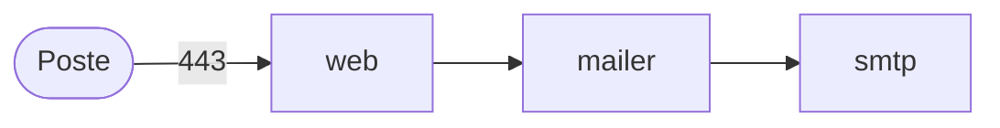

# Architecture cible de VéloCité sur Kubernetes

A FAIRE. Un croquis le lundi (atelier 1), la version finale le mercredi
(après l'atelier 5). Ce document se lit avant `DEPLOIEMENT.md` et
`RUNBOOK.md` : ce qui tourne, où, et pourquoi.

## Vue d'ensemble

Un schéma : les services, qui appelle qui, ce qui vient du poste. Lundi, un
croquis à partir de l'inventaire ; mercredi, les namespaces s'y ajoutent.

Le schéma s'écrit en Mermaid, un format texte que GitHub affiche comme un
dessin. Les flèches se génèrent à partir de la section 2 de l'inventaire,
depuis le dossier `app` :

Windows :

```powershell
$c = docker compose --profile "*" config --format json | ConvertFrom-Json
foreach ($s in $c.services.PSObject.Properties) {
  foreach ($d in $s.Value.depends_on.PSObject.Properties) {
    "  {0} --> {1}" -f $s.Name, $d.Name } }
```

macOS et Linux :

```bash
docker compose --profile "*" config --format json | jq -r '.services | to_entries[]
  | .key as $s | (.value.depends_on // {}) | keys[] | "  \($s) --> \(.)"'
```

Collez les lignes sous `flowchart LR`, puis ajoutez ce que les dépendances ne
disent pas : le poste qui appelle nginx sur 8443, les trois réseaux
(`docker compose config --networks`). Exemple de forme, sans rapport avec
VéloCité :



Votre schéma :

```mermaid
flowchart LR
```

## Les layers d'infrastructure

| Layer | Dossier | Ce qu'il crée | Fréquence |
|---|---|---|---|
| | | | |

## Les deux environnements

| | dev | prod |
|---|---|---|
| | | |

## Ce qui garde la plateforme durcie

## La supervision

## Les choix et ce qu'on a écarté

| Choix | Écarté | Pourquoi |
|---|---|---|
| | | |

## Ce qui reste hors périmètre
